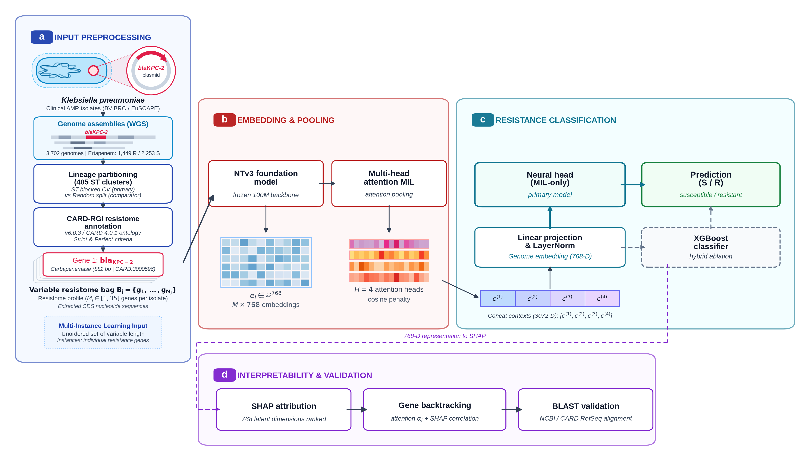
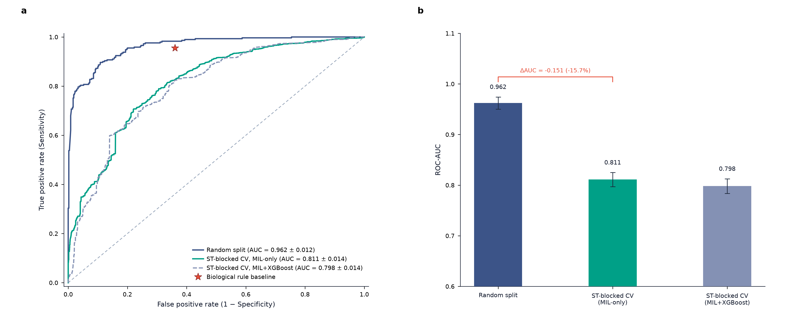

# Lineage-aware evaluation of genomic learning for ertapenem resistance prediction

[](https://www.python.org/downloads/release/python-3120/)
[](https://opensource.org/licenses/MIT)
[](https://doi.org/10.5281/zenodo.22753637)

This repository contains the complete reproducible codebase, analysis scripts, metadata manifests, and prediction outputs supporting the study on genomic antimicrobial resistance (AMR) prediction in *Klebsiella pneumoniae*.

---

## Overview

Predicting antimicrobial resistance directly from genomic sequences is frequently compromised by **clonal data leakage**: isolates belonging to the same Sequence Type (ST) or clonal lineage share near-identical resistomes and genetic backgrounds. When randomly split between training and evaluation sets, standard models exploit lineage markers rather than learning true causal resistance determinants, leading to heavily inflated performance metrics.


*Figure 1: Overview of the proposed Multiple Instance Learning (MIL) framework for isolate-level prediction of ertapenem resistance in Klebsiella pneumoniae ([download vector PDF](results/new/Figure1_updated.pdf)). Gene annotations are embedded with NTv3 (768-D), aggregated across four attention heads (concatenated to 3,072-D), projected via a linear layer and layer normalization into a 768-D genome embedding, and classified by the primary neural head (MIL-only, solid box) or parallel XGBoost classifier ablation (dashed box). The side panel shows latent dimension ranking via SHAP attribution, gene backtracking, and BLAST biological validation.*


*Figure 2: Model performance under random and ST-blocked validation ([download vector PDF](results/new/Figure2_updated.pdf)). (Left) ROC curves under random splitting (AUC = 0.9621, 95% CI: [0.9500, 0.9743]) versus ST-blocked cross-validation (MIL-only AUC 0.8111, 95% CI: [0.7972, 0.8250]; MIL+XGBoost AUC 0.7981, 95% CI: [0.7837, 0.8125]). Red star indicates the biological rule baseline operating point (FPR = 0.361, TPR = 0.954). (Right) Bar chart showing the difference between the random-split historical comparator and the ST-blocked primary estimate.*

To address this:
1. **ST-Blocked Cross-Validation (Primary Evaluation)**: Isolates are grouped strictly by Sequence Type (ST) using 5-fold StratifiedGroupKFold (`random_state=4350`). Under this protocol, the attention-based Multiple Instance Learning (MIL) model achieves an **AUC of 0.8111 (95% CI: [0.7972, 0.8250])**, and the hybrid MIL + XGBoost model obtains an **AUC of 0.7981 (95% CI: [0.7837, 0.8125])**.
2. **Random-Split Historical Comparator**: Under conventional random partitioning (3,848 / 770 test set), the MIL+XGBoost model achieves an **AUC of 0.9621 (95% CI: [0.9500, 0.9743])**. This estimate is retained as a **historical comparator only** — because the random-split and ST-blocked results were obtained with different classifier configurations and cohorts, their absolute AUC difference should not be interpreted as an architecture-matched estimate of the effect of clonal structure. For an architecture-matched comparison: MIL-only under random split achieves AUC 0.9182 vs. AUC 0.8111 under ST-blocking ($\Delta\text{AUC} \approx -0.107$).

---

## Repository Structure

```
├── data/                                # Isolate metadata, manifests, and fold splits
│   ├── dataset_manifest_colab.csv       # Master cohort (3,708 isolates) with STs and splits
│   ├── Tabla_Maestra_ST_5Fold.xlsx      # Master 5-fold ST-blocked cross-validation table
│   ├── cepasv2.xlsx                     # Complete BV-BRC raw metadata table (4,869 isolates)
│   ├── Auditoria_Final_Armonizada.xlsx  # Resistance mechanism audit (Zenodo-derived subset, 854 isolates; 355 resistant)
│   └── README.md
├── notebooks/                           # Step-by-step Jupyter notebooks (Colab & local ready)
│   ├── 01_prepare_dataset.ipynb         # Raw RGI filtering and ST-blocked split curation
│   ├── 02_ST_blocked_validation.ipynb   # 5-fold ST-blocked cross-validation training
│   ├── 03_MIL_XGBoost_OOF_Generation.ipynb # Out-of-fold (OOF) prediction generation
│   ├── 04_random_split_benchmark.ipynb  # Random-split comparator & false-negative profiling
│   ├── 05_analysis_and_figures.ipynb    # Model interpretability, SHAP, and PR curves
│   ├── 06_lineage_aware_validation.ipynb# Reproducible lineage-aware MIL validation pipeline
│   ├── 07_architecture_matched_pipeline.ipynb # Architecture-matched benchmark (Reviewer 2 Comment 3)
│   ├── 08_cohort_3848_audit.ipynb       # Forensic cohort reconstruction and traceability audit
│   └── README.md
├── results/                             # Model predictions and publication-ready figures
│   ├── new/                             # Current Nature Portfolio publication figures (Figures 1–6)
│   ├── supplementary/                   # Supplementary publication figures suite (Figures S1–S5)
│   ├── legacy/                          # Historical reference figures & initial layouts
│   ├── oof_predictions_pooled.csv       # 3,702 pooled out-of-fold cross-validation predictions
│   ├── random_split_predictions.csv     # 770 random split test predictions
│   └── README.md
├── scripts/                             # Standalone scripts to reproduce all paper results
│   ├── new/                             # Active Nature Portfolio figure generation scripts (Figures 1–6)
│   ├── supplementary/                   # Supplementary figure generation script (Figures S1–S5)
│   ├── legacy/                          # Historical reference scripts
│   ├── compute_stats.py                 # Reproduces Table 1, DeLong CIs, VME/ME error rates
│   ├── run_mcnemar.py                   # Executes McNemar test (ML vs. biological rule)
│   ├── test_bootstrap.py                # Performs ST-level cluster bootstrap hypothesis tests
│   └── README.md
├── src/                                 # Modular Python package
│   ├── model.py                         # NTv3MultiHeadMIL and FocalLoss implementations
│   ├── metrics.py                       # DeLong variance, Clopper-Pearson CI, cluster bootstrap
│   └── __init__.py
├── supplementary/                       # Supplementary data manifests, tables, and lab checklists
│   ├── Supplementary_Table_S2_ST_Distribution.xlsx # ST breakdown (416 STs, N=3,708)
│   ├── Supplementary_Table_S2_ST_Distribution.csv
│   ├── Final_Denominators.csv           # Reconciled cohort sizes across all analysis stages
│   ├── Reconciliation_3708_vs_3702.csv  # Isolate-level master-to-OOF traceability
│   ├── de_la_Fuente_Lab_Checklist.pdf   # Completed computational reproducibility checklist
│   └── README.md
├── requirements.txt                     # Pinned Python package dependencies
├── environment.yml                      # Conda / Mamba environment specification
├── LICENSE                              # MIT Open Source License
└── README.md
```

---

## Installation & Environment Setup

Python **3.12** is recommended.

### Option A: Using Conda / Mamba (Recommended)
```bash
conda env create -f environment.yml
conda activate klebsiella-mil
```

### Option B: Using Pip
```bash
python3 -m venv venv
source venv/bin/activate
pip install --upgrade pip
pip install -r requirements.txt
```

---

## Quick Reproduction (1-Command Verification)

All figures, statistical tests, and tables reported in the manuscript can be verified immediately using the standalone reproduction scripts:

```bash
# 1. Compute AUCs, DeLong confidence intervals, and VME/ME error rates (Table 1)
python scripts/compute_stats.py

# 2. Generate Nature Portfolio publication figures (saved to results/new/)
python scripts/new/refine_figure1.py
python scripts/new/plot_paper_figure2.py
python scripts/new/plot_roc_error_analysis.py
python scripts/new/plot_paper_figure3.py
python scripts/new/plot_paper_figure4_ig.py
python scripts/new/plot_paper_figure5_logo.py
python scripts/new/plot_paper_figure6_pr_calibration.py

# 3. Generate Supplementary Figures S1 through S5 (saved to results/supplementary/)
python scripts/supplementary/plot_supplementary_figures.py

# 4. Generate historical/legacy figures (saved to results/legacy/)
python scripts/legacy/figure_auc_comparison.py

# 5. Run McNemar test against the carbapenemase biological rule baseline
python scripts/run_mcnemar.py

# 6. Run cluster bootstrap across the 405 Sequence Type clusters
python scripts/test_bootstrap.py
```

### Key Verified Results

| Protocol / Model | Cohort $N$ | ROC-AUC | 95% Confidence Interval | PR-AUC | VME Rate | ME Rate |
| :--- | :---: | :---: | :---: | :---: | :---: | :---: |
| **ST-Blocked CV (MIL-only)** | 3,702 | **0.8111** | [0.7972, 0.8250] | **0.7404** | 34.1% | 20.4% |
| **ST-Blocked CV (MIL + XGBoost)** | 3,702 | **0.7981** | [0.7837, 0.8125] | **0.6899** | 53.6% | 12.3% |
| **Random Split Historical Comparator** ¹ | 770 | **0.9621** | [0.9500, 0.9743] | **0.9470** | 7.9% | 4.8% |
| **Biological Rule Baseline** (OOF, carbapenemase rule) | 3,702 | — | — | — | 4.6% | 36.1% |

> **Note on Biological Rule Baseline**: The rule (predict Resistant if any carbapenemase gene detected) was applied to the full ST-blocked OOF set ($n = 3,702$). VME = 4.6% (66/1,449 resistant isolates lacking carbapenemases); ME = 36.1%. The `Auditoria_Final_Armonizada.xlsx` file covers a separate, earlier Zenodo-derived subset of 854 isolates (355 resistant) with full mechanism annotation.

- **MIL-only vs MIL+XGBoost (ST-blocked)**: $\Delta\text{AUC} = -0.0130$; paired $t$-test over 5-fold AUCs $p = 0.96$; cluster bootstrap $p > 0.05$ → difference **not significant** (primary tests). *(Note: a pooled DeLong test yields $p = 0.0059$, but it is anti-conservative here as it ignores ST-level clustering and is not used as the primary test.)*
- **Clonal leakage (architecture-matched)**: MIL-only random split (AUC 0.9182) vs MIL-only ST-blocked (AUC 0.8111), $\Delta\text{AUC} \approx -0.107$. The raw difference $0.9621 - 0.8111$ mixes different classifier configurations (MIL+XGBoost vs MIL-only) and **must not** be interpreted as an architecture-matched leakage estimate (see manuscript Discussion).

> ¹ **Random Split Historical Comparator row**: Model = MIL+XGBoost v5.3; decision threshold = 0.50 (default). VME 7.9% and ME 4.8% are reported at this operating point. The threshold sweep (Supplementary Figure S1) shows Recall = 0.824 at threshold 0.50 for MIL-only; results are not directly comparable across configurations. See `scripts/compute_stats.py` to reproduce these figures.

---

## Data Availability & Model Weights

- **Processed Data**: All metadata, manifests, ST labels, and out-of-fold predictions required to reproduce the paper's analytical findings are included directly in `data/` and `results/`.
- **Raw Sequence Data**: Raw genomic assemblies can be downloaded directly from [BV-BRC](https://www.bv-brc.org/) using the accessions listed in `data/cepasv2.xlsx` and `data/dataset_manifest_colab.csv`. RGI (v6.0.3) was executed against the CARD database (v4.0.1).
- **Pretrained Foundation Model**: The nucleotide embedding backbone uses `InstaDeepAI/NTV3_100M_post` available via Hugging Face.
- **Trained Model Weights**: Trained PyTorch checkpoints (`modelo_MIL_v5.1_best_auc.pth`, ~1.3 GB) exceed standard GitHub repository limits (< 100 MB). Checkpoints are deposited on Zenodo [](https://doi.org/10.5281/zenodo.22753637) and can be placed in `models/` for full inference reproduction.

---

## Authors

- **Adolfo Morales Tena** <sup>1</sup> — Independent Researcher
- **Hanqun Cao** <sup>2</sup> — Machine Biology Group, University of Pennsylvania
- **Cesar de la Fuente-Nunez** <sup>2</sup> — Machine Biology Group, University of Pennsylvania *(corresponding author)*
- **Carlos Oscar S. Sorzano** <sup>3</sup> — Biocomputing Unit, Centro Nacional de Biotecnología (CNB-CSIC), Madrid, Spain

<sup>1</sup> Independent Researcher  
<sup>2</sup> Machine Biology Group, Departments of Psychiatry and Microbiology, Institute for Biomedical Informatics, Institute for Translational Medicine and Therapeutics, Perelman School of Medicine, University of Pennsylvania, Philadelphia, PA 19104, USA; Departments of Bioengineering and Chemical and Biomolecular Engineering, School of Engineering and Applied Science, University of Pennsylvania, Philadelphia, PA, USA; Department of Chemistry, School of Arts and Sciences, University of Pennsylvania, Philadelphia, PA, USA; Penn Institute for Computational Science, University of Pennsylvania, Philadelphia, PA, USA.  
<sup>3</sup> Biocomputing Unit, Centro Nacional de Biotecnología (CNB-CSIC), Madrid, Spain

If you use this code, please cite the associated paper (see [CITATION.cff](CITATION.cff)).

---

## License

This project is licensed under the MIT License - see the [LICENSE](LICENSE) file for details.
